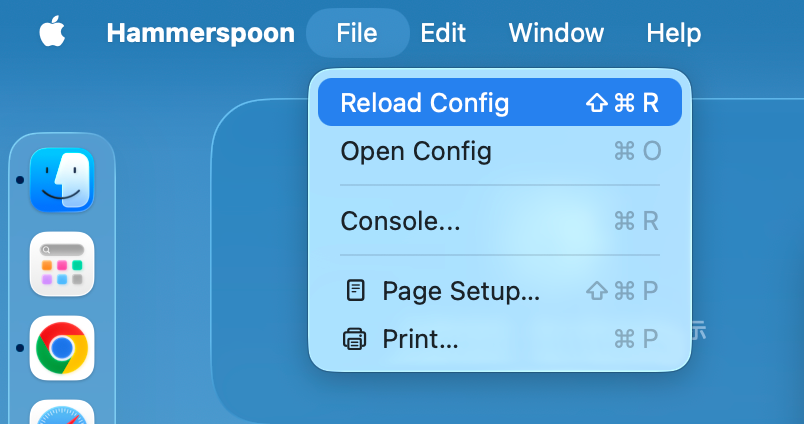
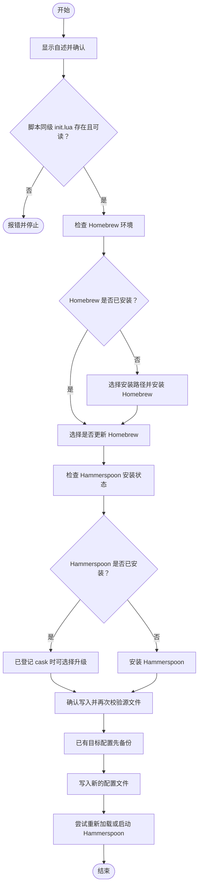

# <span id="前言">[**Hammerspoon**](https://www.hammerspoon.org/) 配置 **macOS** 热键</span>


[toc]

## 一、手动安装步骤 <a href="#前言" style="font-size:17px; color:green;"><b>🔼</b></a> <a href="#🔚" style="font-size:17px; color:green;"><b>🔽</b></a>

- [**Homebrew**](https://brew.sh/) ➤ [**Hammerspoon**](https://www.hammerspoon.org/)
  * 安装 [**Homebrew**](https://brew.sh/)
    
    ```shell
    $SYSTEM_BIN_DIR/bash -c "$(curl -fsSL https://raw.githubusercontent.com/Homebrew/install/HEAD/install.sh)"
    ```
  * 通过 [**Homebrew**](https://brew.sh/) 的 **cask** 安装 [**Hammerspoon**](https://www.hammerspoon.org/) 图形化界面
    
    ```shell
    brew install --cask hammerspoon
    ```
- 写入替换 ➤ `~/.hammerspoon/init.lua`
- 配置完成后，需要重启 [**Hammerspoon**](https://www.hammerspoon.org/) 或点击 `Reload Config` 刷新配置后才会生效。
  
  

## 二、脚本安装（流程图） <a href="#前言" style="font-size:17px; color:green;"><b>🔼</b></a> <a href="#🔚" style="font-size:17px; color:green;"><b>🔽</b></a>

- 将 `./【MacOS】💉Hammerspoon配置注入.command` 与 `./init.lua` 放在同一目录，双击脚本或在终端执行：

  ```shell
  /bin/zsh './【MacOS】💉Hammerspoon配置注入.command'
  ```

- 脚本先显示内置自述并等待回车；确认前可按 `Ctrl+C` 取消。源配置始终按脚本自身所在目录定位，与终端当前目录、用户名和仓库克隆位置无关，不向父目录查找。
- 安装依赖前先检查同级 `init.lua` 是否存在且可读；不满足时立即停止。写入前会再次检查，已有目标配置先备份为 `init.lua.bak.<timestamp>`，再复制源文件并尝试自动重新加载配置。
- 已有可用的 Homebrew 会直接复用；可选的 Homebrew 更新和 Hammerspoon cask 升级均为直接回车跳过、输入任意字符后回车执行。已有独立安装的 Hammerspoon.app 会跳过重复安装。
- 运行日志位于系统临时目录中的 `【MacOS】💉Hammerspoon配置注入.log`，每次运行重新记录，实际路径会显示在自述中。



出现“未找到脚本同级目录的 init.lua”时，对照日志中的“脚本目录”和“内容来源”：后者应为前者直接追加 `/init.lua`。确认同级文件名为 `init.lua` 且可读，再重新运行。首次安装依赖需要网络；网络安装失败时先处理对应下载错误。

## 三、快捷键清单 <a href="#前言" style="font-size:17px; color:green;"><b>🔼</b></a> <a href="#🔚" style="font-size:17px; color:green;"><b>🔽</b></a>

| 快捷键 | 功能 |
| --- | --- |
| `⌘ + 1` | 打开 / 切换 `SourceTree` |
| `⌘ + 2` | 打开 / 切换「备忘录」 |
| `⌘ + 3` | 打开 / 切换 `Telegram Web` |
| `⌘ + 4` | 打开 / 切换 `LarkSuite` |
| `⌘ + 5` | 打开 / 切换 `Codex` |
| `⌘ + I` | 打开 / 切换 `Google Chrome` |
| `⌘ + Y` | 打开 / 切换「有道词典」 |
| `⌘ + ⇧ + F` | 打开 / 切换 [**Figma**](https://www.figma.com/) |
| `⌘ + D` | 打开 `~/Downloads` 下载文件夹 |
| `⌘ + T` | 打开 `Terminal`；已运行时新建一个终端窗口 |
| `⌥ + Z` | 打开「系统设置」里的「隐私与安全」 |
| `⌘ + ⌥ + ⌃ + R` | 重新加载 [**Hammerspoon**](https://www.hammerspoon.org/) 配置 |

## 四、`⌥ + Z` 隐私与安全快捷键 <a href="#前言" style="font-size:17px; color:green;"><b>🔼</b></a> <a href="#🔚" style="font-size:17px; color:green;"><b>🔽</b></a>

- `⌥ + Z` 对应 [**Hammerspoon**](https://www.hammerspoon.org/) 里的 `alt + z`，用于快速打开 [**macOS**](https://www.apple.com/macos/)「系统设置」➤「隐私与安全」。
  
  ```lua
  hs.hotkey.bind({"alt"}, "z", function()
    openPrivacySecurity()
    notify("隐私与安全")
  end)
  ```
- 这个快捷键只负责打开目标页面；像「仍要打开」这类安全确认按钮，仍建议手动点击，别做自动化点击。

[**Homebrew**](https://brew.sh/) 安装路径由用户选择：已有可运行安装时复用；确实需要安装时先强提示，只有精确输入大写 `YES` 才选择系统标准目录，其它输入或直接回车选择当前用户的 `.local/homebrew`。`YES` 只表示选择路径，权限与密码由官方安装器实际处理；有管理员权限也可以选用户目录。选定路径失败立即停止，不自动切换；`Ctrl+C` / 输入结束取消整个任务。

<a id="🔚" href="#前言" style="font-size:17px; color:green; font-weight:bold;">我是有底线的➤点我回到首页</a>
